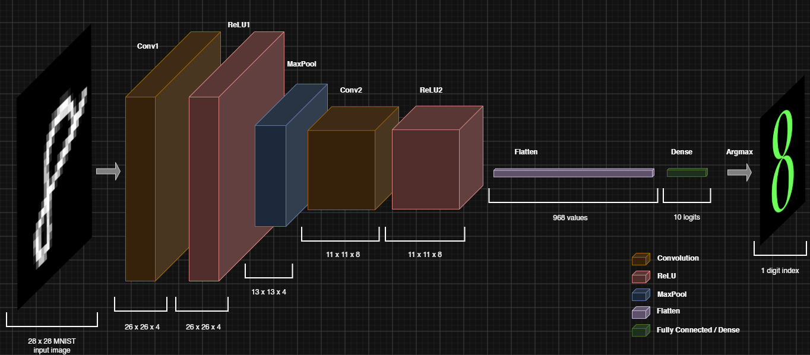

# MNIST Convolutional Neural Network (CNN) in SystemVerilog

This is a convolutional neural network in SystemVerilog using fixed-point arithmetic and verified in simulation. Notably, this design is built for the MNIST dataset.

> **Note:** This project serves as a foundational predecessor to a fully pipelined, streaming CNN targeted for the Artix-7 FPGA which I have been working on :D 
> 
> While this version relies on FSM-based sequencing and buffering rather than a full streaming pipeline, it is a complete and fully functional design in its own right (though not deployed to the FPGA). Its primary objectives were to:
> 
> * **Establish fixed-point arithmetic** and validate its behaviour.
> * **Verify CNN feasibility** before investing in a fully pipelined architecture.
> * **Develop a reference model and verification framework** that can be integrated into the development of the pipelined version for continuous testing and verification.


**Conv1 -> ReLU1 -> MaxPool -> Conv2 -> ReLU2 -> Flatten -> Dense -> Argmax**

## Contents

- [Project Overview](#project-overview)
- [Network Architecture](#network-architecture)
- [How Data Moves](#how-data-moves)
	- [Image Input](#image-input)
	- [Tensor Ordering](#tensor-ordering)
- [Fixed-Point Arithmetic](#fixed-point-arithmetic)
	- [Pixel Conversion](#pixel-conversion)
	- [Products and Accumulation](#products-and-accumulation)
	- [Quantization](#quantization)
	- [Exported Parameters](#exported-parameters)
- [Training and Export](#training-and-export)
- [Verification](#verification)
- [Run the Simulation](#run-the-simulation)
- [Repository Guide](#repository-guide)

## Project Overview

I started this project to explore how machine learning can be implemented in hardware. This is a SystemVerilog CNN that classifies MNIST digits using fixed-point arithmetic, checked against a bit-accurate Python reference model made with numpy. The design takes a row-major 28 x 28 grayscale image and predicts a digit from 0 to 9.

## Network Architecture

Each image passes through Conv1, ReLU, 2 x 2 max pooling, Conv2, ReLU, channel-major flattening, a dense classifier, and argmax.

| Stage | Input | Output | Role |
|---|---:|---:|---|
| Image input | 28 x 28 x 1 | 28 x 28 x 1 | Accept raw unsigned pixel bytes |
| Conv1 | 28 x 28 x 1 | 26 x 26 x 4 | Extract local image features |
| ReLU1 | 26 x 26 x 4 | 26 x 26 x 4 | Remove negative activations |
| MaxPool | 26 x 26 x 4 | 13 x 13 x 4 | Downsample each channel independently |
| Conv2 | 13 x 13 x 4 | 11 x 11 x 8 | Combine spatial and channel features |
| ReLU2 | 11 x 11 x 8 | 11 x 11 x 8 | Apply the second activation |
| Flatten | 11 x 11 x 8 | 968 values | Reorder features for classification |
| Dense | 968 values | 10 logits | Produce one score per digit |
| Argmax | 10 logits | 1 digit index | Select the highest-scoring class |

Both convolutions use stride 1 and valid padding. Pooling uses stride 2 and operates independently on each channel. The four-bit output is a class index from 0 to 9.

## How Data Moves

The top level buffers one image and processes one stage at a time; it is not a streaming pipeline. [ might be eventually in version 2 :) ]

### Image Input

The host (tb in sim) asserts `start` while the controller is in the IDLE state. The control FSM then asserts `ready` while it is collecting the 784 image bytes. A byte is accepted only on a rising clock edge where both `pixel_valid` and `ready` are high. If `pixel_valid` pauses, the input count holds.

The control FSM sequences each stage after its input map is available. Transfers are accepted on a rising edge when `enable` and the corresponding `valid` are high. Buffers hold the maps between stages... Keep in mind, I haven't given the design internal backpressure. ReLU is combinational. Dense has a separate start pulse, asserts `dense_done` after the final feature, and the top-level asserts `done` for one cycle with `predicted_digit` valid.

### Tensor Ordering

Images and spatial maps are row-major, with channels adjacent at each location. Conv2 windows and weights use channel-major kernel order:

```text
window_index = channel * 9 + kernel_row * 3 + kernel_col
```

Flatten reorders the 11 x 11 x 8 Conv2 map to channel-major order to match the dense weights:

```text
flat_index = channel * 121 + row * 11 + column
```

## Fixed-Point Arithmetic

The datapath uses signed integer encodings. In `Qm.n`, `n` is the number of fractional bits.

| Quantity | RTL representation | Scale |
|---|---|---|
| Raw input pixel | unsigned 8-bit | integer 0 to 255 |
| Converted input sample | signed 8-bit | Q1.7 |
| Convolution and Dense weights | signed 8-bit | Q1.7 |
| Biases | signed 20-bit | Q6.14 |
| Activations, pooled values, logits | signed 20-bit | Q6.14 |
| MAC accumulator | signed 40-bit | stage-dependent product scale |

### Pixel Conversion

The incoming pixel remains unsigned. The datapath converts it using:

```text
sample_q7 = pixel_in[7:1]
```

This is `floor(pixel / 2)`, zero-extended as a signed Q1.7 sample. Thus 0 maps to 0, 128 to 64, and 255 to 127.

### Products and Accumulation

- **Conv1:** Q1.7 x Q1.7 produces Q2.14; the Q6.14 bias needs no shift.
- **Conv2 and Dense:** Q6.14 x Q1.7 produces Q7.21; shift the Q6.14 bias left by 7 before accumulation, then arithmetic-shift the sum right by 7.
- **Accumulation and saturation:** MACs use 40 bits. Outputs saturate to signed 20-bit range (-524,288 to 524,287), rather than wrapping.
- **Activation:** ReLU follows each convolution; Dense logits are not rectified.

### Quantization

The Python exporter quantizes weights to signed Q1.7 and biases to signed Q6.14. It rounds to nearest with ties away from zero, then saturates to the representable range. The integer reference uses the same bias alignment, shifts, saturation, ReLU, and pooling rules as the RTL.

### Exported Parameters

The export contains 10,026 parameters:

| Parameter group | Count |
|---|---:|
| Conv1 weights and biases | 36 weights + 4 biases |
| Conv2 weights and biases | 288 weights + 8 biases |
| Dense weights and biases | 9,680 weights + 10 biases |

Weights are signed 8-bit two's-complement values (two hex digits per value); biases are signed 20-bit values (five digits). The files are `conv1_weights.mem`, `conv2_weights.mem`, `dense_weights.mem`, and `biases.mem`; biases are ordered Conv1, Conv2, then Dense.

## Training and Export

I created a training model with float arithmetic in PyTorch. `model/float_training_model.py` defines the `CNN` class with the same network as the RTL (Conv1, ReLU, 2x2 max pool, Conv2, ReLU, flatten, dense). `model/train_and_export.py` trains it on the 60,000-image MNIST training split:

- **Input scaling:** each pixel becomes `floor(pixel / 2) / 128`, the floating-point form of the RTL's Q1.7 conversion (the rtl and int-refernce model keep it at the integer fixed point range instead)
- **Training setup:** 5 epochs, batch size 64, Adam with a learning rate of 0.001, and cross-entropy loss, on the CPU. The Python, NumPy, and PyTorch seeds are 2026 (so creative I know), the shuffled data loader is seeded, and PyTorch deterministic algorithms are enabled.
- **Hardware ranges:** after every optimizer step, weights are clamped to [-1, 127/128] and biases to [-32, 32 - 2^-14], the real-value ranges of Q1.7 and Q6.14. Training therefore never produces a value the hardware cannot store.

Training runs entirely in floating point!

After training, `quantize_model` in `model/export_utils.py` converts the weights and biases to integers as described under Quantization, and `write_mem` writes them as hex `.mem` files in `tb/test_vectors/`, checking that each file has the expected number of values. The script also takes the first 10 images of each digit from the 10,000-image MNIST test split, 100 in total in digit-major order, and writes them as raw unsigned pixels to `input_images.mem`, with their truth labels in `labels.mem`.

## Verification

`model/int_reference_model.py` is a _bit-accurate integer refernce model_ of the RTL arithmetic, written with NumPy on `int64` values. `predict(image, params)` takes one raw 28 x 28 image and the quantized parameters, and follows the RTL stage by stage: the `pixel >> 1` conversion, Conv1, saturation, ReLU, 2 x 2 max pooling, Conv2 with its bias alignment and right shift, saturation, ReLU, channel-major flatten, Dense, and argmax. It builds the 3 x 3 windows with `sliding_window_view` from numpy library and does the multiply-accumulates with `einsum`.

`train_and_export.py` runs the integer reference model on the 100 test images using the same quantized parameters it exports, then writes the expected digits to `golden_outputs.mem` and all ten class logits per image to `golden_logits.mem`.

`tb/tb_top.sv` loads those reference outputs along with `input_images.mem` and `labels.mem`, streams each image into `top_classifier` through the `ready` / `pixel_valid` handshake, and waits for `done`. It compares the RTL's predicted digit and each of its ten logits against the reference values; any mismatch fails the simulation. The testbench also compares each predicted digit with its MNIST label, reports accuracy, and, on the full 100-image run, fails if fewer than 90 are correct. The module-level testbenches in `tb/` cover the individual modules (`make -C sim unit-test`).

## Run the Simulation

Prerequisites: `iverilog` and `vvp`; install `gtkwave` only if you want waveforms. Run commands from the repository root.

```sh
# Run all unit tests and the 100-image RTL regression
./sim/run_sim.sh

# Run only the module-level tests
make -C sim unit-test

# Run only the 100-image RTL regression
make -C sim run

# Run the first test image and open its waveform (requires GTKWave)
make -C sim wave

# Remove generated simulator files
make -C sim clean
```

The full regression compares RTL predictions with the committed golden outputs and reports MNIST label accuracy. Fixtures are already included. To regenerate them, install `model/requirements.txt` in your Python environment and run `python model/train_and_export.py`; it retrains for five epochs and overwrites the fixtures.

## Repository Guide

| Path | Purpose |
|---|---|
| `rtl/` | SystemVerilog datapath modules and the top-level integration |
| `model/` | Float training model, fixed-point reference model, quantization, and memory-file exporter |
| `tb/` | Module-level and top-level simulation testbenches |
| `tb/test_vectors/` | Generated/created weights, images, reference predictions, and labels |
| `sim/` | Icarus compile/run workflow and waveform configuration |
| `README.md` | Project and simulation guide |
